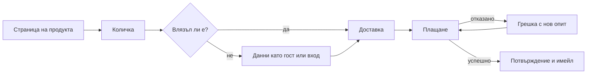

# Потребителски потоци и схематични макети

Реши какво трябва да направи потребителят и в какъв ред, преди да решаваш как ще изглежда. Дръж детайлността ниска, за да са промените евтини.

## Стъпки
1. **Определи потребителите и целите им.** За всеки основен вид потребител напиши по един ред: „Като <потребител> искам да <цел>, за да <причина>.“ Избери 1–3 най-важни цели и проектирай тях първо.
2. **Начертай основния път.** Изброй стъпките от входната точка до успеха, по едно действие на стъпка. Преброй ги, после опитай да махнеш или слееш стъпки (искай данни по-късно, използвай стойности по подразбиране, позволи поръчка без регистрация).
3. **Добави разклонения и гранични случаи.** Грешки, празни състояния, първо използване и завръщащ се потребител, забравена парола, липса на връзка, отказано плащане, бутон „Назад“, отказ по средата, отказан достъп.
4. **Състави списък на екраните.** Превърни потока в опис на екраните: име, предназначение, основно действие, показвани данни, откъде се влиза и къде се излиза.
5. **Направи схематичен макет на всеки екран.** Кутии и истински надписи (не запълващ текст); съдържание по важност; едно основно действие. Първо за телефон, ако продуктът се ползва от телефони.
6. **Мини през потока.** Прочети го на глас като потребител. На всяка стъпка питай: знае ли потребителят къде е, какво да направи и как да се върне?
7. **Тествай евтино.** Покажи макетите на 3–5 души от аудиторията, дай им задача („купи карта за подарък на приятел“), мълчи и отбелязвай къде се колебаят. Поправи най-големите проблеми и повтори.
8. **Предай на изпълнителите.** Опиши поведението (правила за проверка на полетата, какво става при грешка, зареждане) и дръж схемата на потока до макетите.

## Примерен поток (Mermaid)


## Примерен текстов макет
```
+-----------------------------------+
| < Назад             Стъпка 2 от 3 |
| Адрес за доставка                 |
| [Име и фамилия                 ]  |
| [Улица и номер                 ]  |
| [Град        ] [Пощенски код   ]  |
| ( ) До офис   (o) До адрес        |
| [        Към плащане            ] |
+-----------------------------------+
```

## Капани
- Започване с детайлен визуален дизайн; тогава хората коментират цветовете, а не потока.
- Проектиране само на основния път; повечето запитвания към поддръжката идват от граничните случаи.
- Искане на регистрация, преди потребителят да е видял ползата.
- Стъпки с повече от едно основно решение; раздели ги или показвай информацията постепенно.
- Копиране на потока на голямо приложение без контекста му (неговите потребители вече го познават).
- Въпрос към тестващите „харесва ли ви?“ вместо наблюдение как изпълняват задача.

## Резултат
Върни целите на потребителите, потока (като списък или диаграма в Mermaid) с граничните случаи, описа на екраните, текстови макети или макети от прости кутии за ключовите екрани, отворените въпроси и кратък план за тест с 2–3 задачи.
