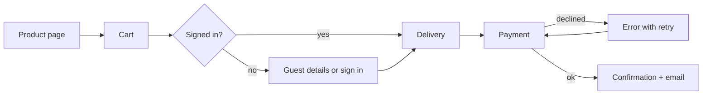

# UX flows and wireframes

Decide what the user needs to do and in what order before deciding how it looks. Keep fidelity low so changes stay cheap.

## Steps
1. **Define users and goals.** For each main user type write one line: "As a <user>, I want to <goal> so that <reason>." Pick the 1-3 most important goals; design those first.
2. **Map the happy path.** List the steps from entry point to success, one action per step. Count them; then try to remove or merge steps (ask for data later, use defaults, allow guest checkout).
3. **Add branches and edge cases.** Errors, empty states, first-time use vs returning user, lost password, no network, payment declined, back button, cancel midway, permission denied.
4. **List screens.** Turn the flow into a screen inventory: name, purpose, main action, data shown, entry and exit points.
5. **Wireframe each screen in low fidelity.** Boxes and real (not lorem ipsum) labels; content in priority order; one primary action. Mobile first when the product is used on phones.
6. **Walk through it.** Read the flow aloud as the user. At each step ask: does the user know where they are, what to do next, and how to go back?
7. **Test cheaply.** Show the wireframes to 3-5 people from the audience, give them a task ("buy a gift card for a friend"), stay silent and note where they hesitate. Fix the top problems and repeat.
8. **Hand off.** Annotate behaviour (validation rules, what happens on error, loading), and keep the flow diagram next to the wireframes.

## Example flow (Mermaid)


## Example text wireframe
```
+-----------------------------------+
| < Back            Step 2 of 3     |
| Delivery address                  |
| [Full name                     ]  |
| [Street and number             ]  |
| [City        ] [Postcode       ]  |
| ( ) Courier office  (o) Address   |
| [        Continue to payment    ] |
+-----------------------------------+
```

## Pitfalls
- Starting in high-fidelity visuals; people then comment on colours, not on the flow.
- Designing only the happy path; most support requests come from edge cases.
- Asking for account creation before showing value.
- Steps with more than one primary decision; split them or use progressive disclosure.
- Copying a big app's flow without its context (its users already know it).
- Asking test users "do you like it?" instead of watching them do a task.

## Output
Return the user goals, the flow (as a list or Mermaid diagram) including edge cases, the screen inventory, text or simple-box wireframes for the key screens, open questions, and a short test plan with 2-3 tasks.
